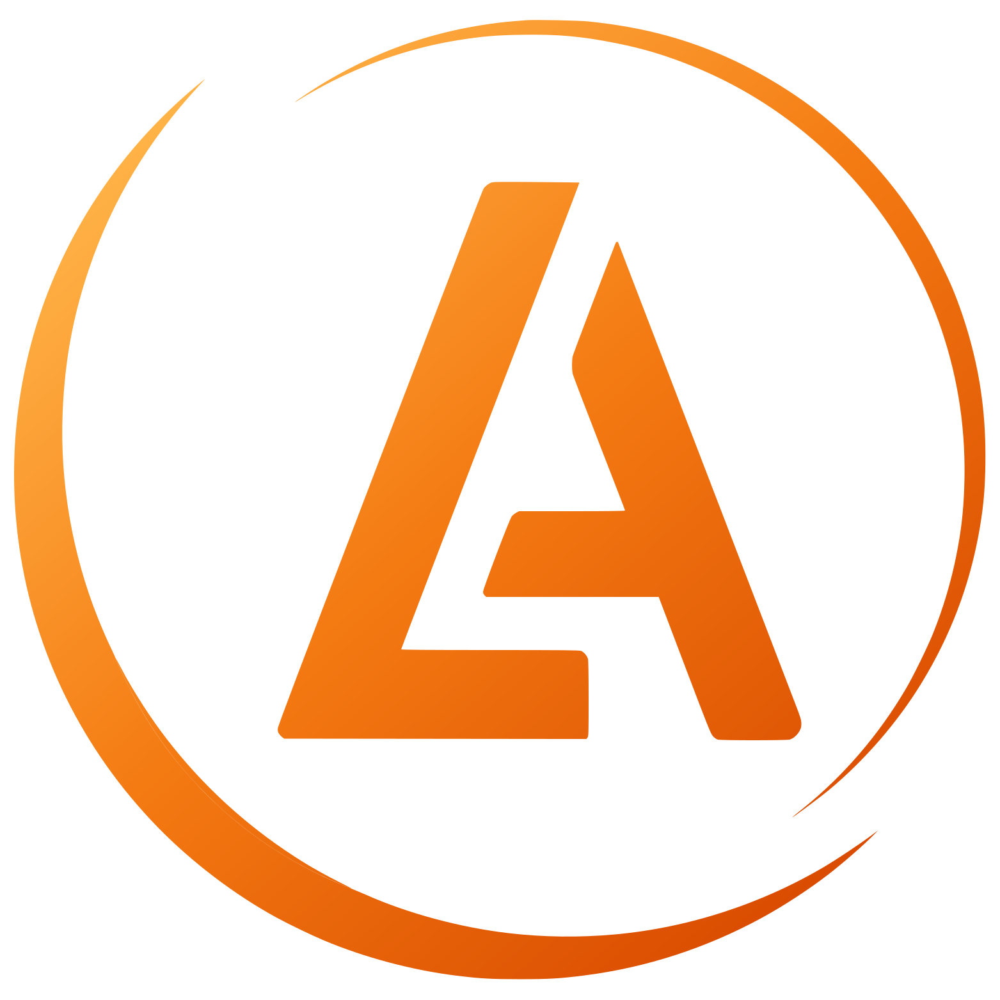

<div align="center">
  
  <h1>LaRouter Image Generation Skill</h1>
  <p>OpenAI-compatible image generation and editing through LaRouter.</p>
</div>

<p align="center">
  <a href="https://github.com/zhuylanz/larouter-image-generation-skill">GitHub Repository</a>
  ·
  <a href="https://lapage.vn">LaPage Digital</a>
</p>

Use this skill to generate and edit images through LaRouter's OpenAI-compatible
image endpoints from Codex and other AI agents.

## Install

Give your agent this repository link and ask it to add the skill:

```text
https://github.com/zhuylanz/larouter-image-generation-skill
```

For a local checkout:

```sh
git clone https://github.com/zhuylanz/larouter-image-generation-skill
```

The skill instructions are in [SKILL.md](SKILL.md).

## Updates

The skill checks this repository for a newer `VERSION` each time it is used.
When there is one, the agent pulls the new instructions (or downloads them if
the skill is not a git checkout) and follows them. If GitHub is unreachable it
continues with the installed version.

Maintainers: on every change to the instructions, bump `VERSION` and
`metadata.version` in `SKILL.md` together, or installed agents will not update.

## What It Supports

- Text-to-image generation through `/v1/images/generations`.
- Single-image and multi-image edits through `/v1/images/edits`.
- OpenAI-compatible JSON requests with Codex image models.
- Secure authentication through `LAROUTER_API_KEY` or the local Codex
  configuration fallback.
- Base64 image response decoding when a local output file is requested.

## Endpoint

The default LaRouter image API is:

```text
https://i-larouter.lapage.vn/v1
```

The full request and error-handling workflow is documented in
[SKILL.md](SKILL.md).

## Authentication

Set the API key in the environment when possible:

```sh
export LAROUTER_API_KEY='your-token'
```

The skill never prints or stores credentials. If the environment variable is
unset, it can use the `experimental_bearer_token` from `~/.codex/config.toml`
for the request only.

## About LaPage Digital

LaPage Digital builds practical digital systems for growing businesses,
including websites, content platforms, automation, and AI-enabled operations.
This skill packages a predictable LaRouter workflow for those environments.

## License

This repository contains LaPage Digital workflow guidance for LaRouter image
operations. Contact LaPage Digital before redistributing or adapting it for
another organization.
